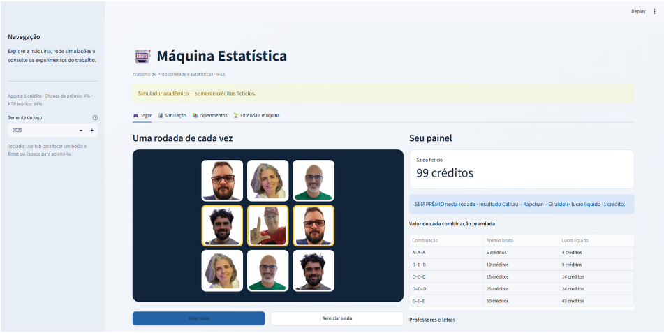
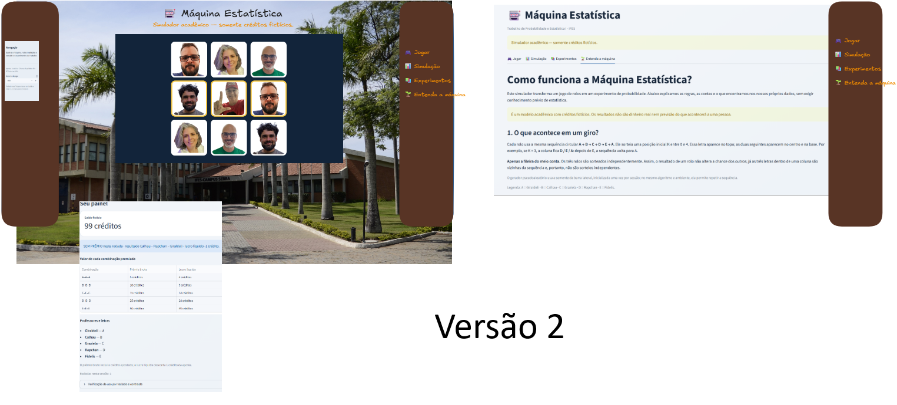

# Máquina Estatística — IFES

Projeto acadêmico do Trabalho 1 de Probabilidade e Estatística I. O programa simula uma máquina de três rolos para explorar probabilidades, pagamentos e resultados de experimentos.

> **Simulador acadêmico: utiliza somente créditos fictícios.**

## Integrantes

- Gustavo Gomes
- Laís Schmitz
- Raquel Neres

## Requisitos e instalação

- Python 3.10 ou superior
- Dependências listadas em `requirements.txt`

Na pasta do projeto, instale as dependências:

```bash
python -m pip install -r requirements.txt
```

## Como executar

Para gerar ou atualizar os experimentos, tabelas, gráficos e metadados, execute:

```bash
python maquina_estatistica.py
```

O programa também executa as verificações automatizadas. O resultado de cada verificação fica em `resultados/extra_testes_automatizados.csv`. Se alguma falhar, a execução termina com um aviso.

Para abrir a interface interativa:

```bash
python -m streamlit run app.py
```

O Streamlit informa o endereço local para abrir no navegador. Na página **Simulação**, é possível escolher o número de rodadas e a semente; a tabela daquela simulação pode ser baixada em CSV.

## Onde estão os resultados

Os arquivos gerados e usados pelos experimentos ficam na pasta `resultados/`:

Os gráficos PNG ficam na mesma pasta dos CSVs. As tabelas podem ser abertas em planilhas ou em um editor de texto. Os arquivos de resultados são atualizados quando se executa `maquina_estatistica.py`.

## Parâmetros, sementes e reprodutibilidade

O modelo usa três rolos, símbolos A, B, C, D e E, aposta de 1 crédito fictício e pagamentos-base de 5, 10, 15, 25 e 50 créditos para as respectivas trincas. Somente a linha central é avaliada. Cada parada é sorteada uniformemente e os rolos são sorteados de forma independente.

O sorteador é `random.Random`, que utiliza o algoritmo Mersenne Twister. Uma semente permite repetir uma sequência no mesmo algoritmo e ambiente; ela não garante uma sequência igual em outro gerador ou versão.

As versões e sementes estão registradas em `resultados/metadados_execucao.json`. O ambiente local usado para a interface tem Streamlit 1.65.0. 

## O que há em cada página

- **Jogar:** permite girar os rolos usando créditos fictícios, acompanhar o saldo e o número de rodadas da sessão, ou reiniciar o saldo. A tabela lateral mostra os trios premiados e seus pagamentos. Só a linha central é avaliada. A página inclui música e efeito sonoro; a reprodução depende das permissões do navegador.
- **Simulação:** permite escolher a quantidade de rodadas e a semente aleatória. Apresenta métricas de prêmios, RTP e lucro médio, gráficos das frequências e do lucro médio acumulado, além de uma tabela para baixar em CSV.
- **Experimentos:** reúne tabelas e gráficos dos experimentos E1–E5 já gerados: distribuição de resultados, médias acumuladas, saldos dos participantes, probabilidade condicional e comparação de pagamentos. Para atualizar esses arquivos, execute `python maquina_estatistica.py`.
- **Entenda a máquina:** explica as regras dos rolos, as probabilidades, os pagamentos e a diferença entre prêmio bruto e lucro líquido. Também apresenta os resultados dos experimentos e fontes para aprofundar o estudo.


## Ferramentas e declaração de uso de IA

**Houve uso de ferramentas de IA como apoio ao projeto.** Elas auxiliaram na revisão e sofisticação do texto; o NotebookLM foi usado para pesquisar materiais e esclarecer dúvidas durante o desenvolvimento. Também para conferir as regras e os valores teóricos do modelo. 

## Desenvolvimento visual

O layout visual foi elaborado no Excalidraw.

<div align="center">
  
  <br><br>
  
  <br><br>
  
  <p>Linha do tempo do desenvolvimento visual</p>
</div>
