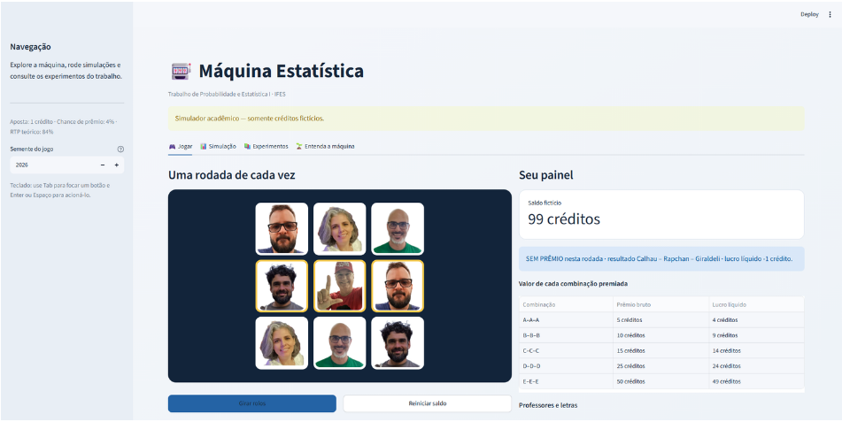
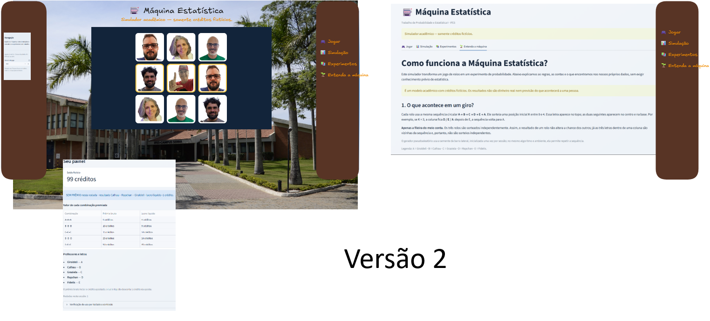

# Máquina Estatística — IFES

Projeto acadêmico para o Trabalho I de Probabilidade e Estatística I. O programa simula uma máquina de três rolos e permite explorar probabilidades, pagamentos e resultados de diferentes experimentos.

> **Simulador acadêmico: utiliza somente créditos fictícios.**

## Requisitos

- Python 3.10 ou superior
- Dependências listadas em `requirements.txt`

Instale as dependências na pasta do projeto:

```bash
pip install -r requirements.txt
```

## Executar os experimentos

Rode o programa principal:

```bash
python maquina_estatistica.py
```

Essa execução atualiza os arquivos da pasta `resultados/` e roda as verificações automatizadas. Os resultados das verificações ficam em `resultados/extra_testes_automatizados.csv`; se alguma falhar, o programa encerra com um aviso.

Os resultados incluem tabelas CSV, gráficos PNG e metadados da execução. Para reproduzir as análises, use os mesmos arquivos e sementes registrados no código e em `resultados/metadados_execucao.json`.

## Abrir a interface

Inicie a aplicação interativa com:

```bash
streamlit run app.py
```

Se necessário, use `python -m streamlit run app.py`. O Streamlit mostrará o endereço local para abrir no navegador.

### O que há em cada página

- **Jogar:** permite girar os rolos usando créditos fictícios, acompanhar o saldo e o número de rodadas da sessão, ou reiniciar o saldo. A tabela lateral mostra os trios premiados e seus pagamentos. Só a linha central é avaliada. A página inclui música e efeito sonoro; a reprodução depende das permissões do navegador.
- **Simulação:** permite escolher a quantidade de rodadas e a semente aleatória. Apresenta métricas de prêmios, RTP e lucro médio, gráficos das frequências e do lucro médio acumulado, além de uma tabela para baixar em CSV.
- **Experimentos:** reúne tabelas e gráficos dos experimentos E1–E5 já gerados: distribuição de resultados, médias acumuladas, saldos dos participantes, probabilidade condicional e comparação de pagamentos. Para atualizar esses arquivos, execute `python maquina_estatistica.py`.
- **Entenda a máquina:** explica as regras dos rolos, as probabilidades, os pagamentos e a diferença entre prêmio bruto e lucro líquido. Também apresenta os resultados dos experimentos e fontes para aprofundar o estudo.

## O que o projeto calcula

- Experimentos E1–E5: frequências e lucro, médias acumuladas, trajetórias de saldo, probabilidades condicionais e comparação de pagamentos.
- Análises complementares: intervalo normal aproximado de 95% para a média do lucro, comparação de tabelas com o mesmo RTP, limites de exposição e análise de sensibilidade.
- Verificações automatizadas de pagamentos, cálculos, reprodutibilidade e casos-limite.

Na comparação de mesmo RTP, os resultados apresentam pagamentos e dispersão dos lucros; saldos finais de participantes não são calculados nessa análise. A análise de limites de exposição apresenta percentuais de ganho, empate, perda e esgotamento, além de saldos e rodadas médias.

## Como interpretar

- O intervalo de 95% usa uma aproximação normal para a média amostral de uma sequência do E1. Não é um intervalo para resultados individuais.
- Resultados simulados podem variar em relação aos valores teóricos por causa da variabilidade aleatória.
- A simulação é didática e não estima perdas ou prevalência de transtornos na população.
- Consulte o enunciado completo antes de usar os resultados no relatório e redija as interpretações com suas próprias palavras.

## Ferramentas e declaração de uso de IA

O layout visual foi elaborado no Excalidraw. Ferramentas de IA foram usadas como apoio à implementação e revisão do projeto. O NotebookLM foi usado para pesquisar materiais e esclarecer dúvidas durante o desenvolvimento.

## Cada etapa no desenvolvimento da interface

<div align="center">
  
  <br><br>
  
  <br><br>
  
  <p>Linha do tempo</p>
</div>
